# claude-mods

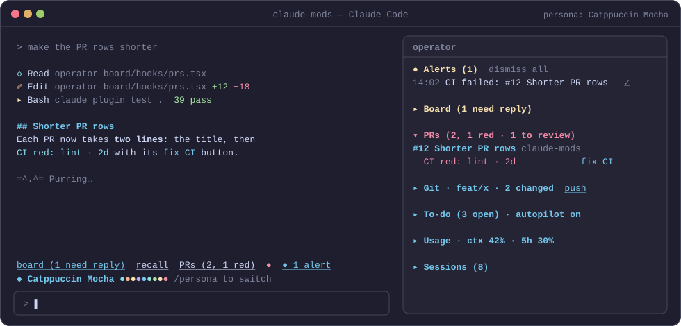

Mods for [Claude Code](https://claude.com/claude-code), published as a plugin marketplace. What changed in each version: [CHANGELOG.md](CHANGELOG.md) and [Releases](https://github.com/kg-ng/claude-mods/releases).

| Mod | Version | What it does |
|---|---|---|
| [`operator-board`](operator-board) | 0.18.1 | One side pane for running a session: a board of what's waiting on you, a to-do list with autopilot, usage, git, earlier sessions, quick prompts, your PRs and recall. Alerts you can find again. |
| [`persona`](persona) | 0.7.1 | Themes for the terminal, Claude's replies and the panels: colours, tool icons, spinner words and an animated scene while Claude works. 24 built-ins, or make your own. |
| [`guard`](guard) | 0.1.0 | A seatbelt for Claude's shell commands: stops pushes onto protected branches and `rm -rf` outside the project, and strips Claude co-author lines from commits and PRs. |
| [`diff-cards`](diff-cards) | 0.1.0 | Folds each edit's diff in the transcript to one line, `+12 −18 · 2 hunks`, with **show diff** to unfold it. |
| [`turn-meter`](turn-meter) | 0.1.0 | Each turn's tokens and cost on its closing line, `Baked for 42s · 180k in · 3.1k out · $0.41`, expensive turns in amber. |
| [`chimes`](chimes) | 0.1.0 | Soft sounds for when Claude finishes, needs you, or a mod reports CI passed or failed. Quiet while you type. macOS. |
| [`focus`](focus) | 0.1.0 | A focus timer in the status line: `/focus-timer 25` holds other mods' notifications and sounds until the break, then sends one summary. |

**Also for GitHub Copilot CLI:** [`copilot/operator-board`](copilot/operator-board) brings the board, to-do and checkpoint tools to Copilot CLI extensions, sharing the same files, so both tools see one list. No pane: Copilot extensions don't have one.

### What's new in operator-board 0.18.0

- **Crew** in the band: your running subagents live above the prompt, with what each is doing, its time and tokens, and **view**, **msg** and **stop**.

From 0.17.0:

- **Model** in Usage: the model Claude is using, its tokens this session (in, out, % cached), and a **/model** button.

From 0.16.0:

- **/btw** in Quick prompts: ask a side question without interrupting Claude.
- **Advisor** in Usage: how often Claude consulted the advisor this session, and a **/advisor** button.

Earlier versions: [CHANGELOG.md](CHANGELOG.md).

### Before and after

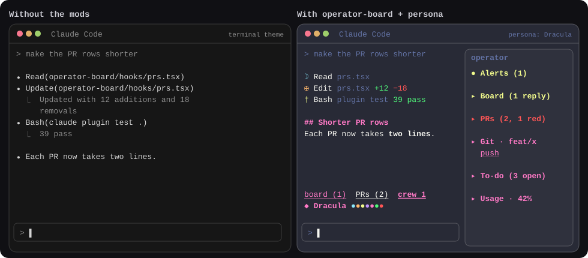


> The pictures and animations in this README are drawn from the mods' render code with sample data. They are illustrations, not screenshots. Each one is painted in a different persona, named in its corner, so you can see the colours.

## Requirements

- Claude Code with plugin hooks modules (built on 2.1.323; the GitHub check runs 2.1.330).
- `git` for the Git section, and the [GitHub CLI](https://cli.github.com) (`gh auth login`) for the PRs section. Everything else works without them.
- The operator pane docks on the right in Claude Code's fullscreen layout from 110 columns. Below that it sits above the prompt instead.

## Install

```sh
claude plugin marketplace add kg-ng/claude-mods
claude plugin install operator-board@claude-mods
claude plugin install persona@claude-mods
claude plugin install guard@claude-mods
claude plugin install diff-cards@claude-mods
claude plugin install turn-meter@claude-mods
claude plugin install chimes@claude-mods
claude plugin install focus@claude-mods
claude plugin install diff-cards@claude-mods
claude plugin install turn-meter@claude-mods
claude plugin install chimes@claude-mods
claude plugin install focus@claude-mods
```

You can install either mod on its own. **Restart Claude Code** afterwards to load them.

To check they loaded, type `/operator` (the pane opens) and `/persona` (the picker opens).

## operator-board

### See it in action

**How an alert works:** Claude finishes with a question, you hear a chime and get a notification named after the folder, the alert waits in the pane, and it clears itself once you answer.


**From an edit to a merge:** Git shows what Claude changed, the header offers **push** and then **open PR**, and when CI goes green you get an alert and a **merge** button.


### The pane

- **Open or close it** with `/operator`. It also opens by itself when a session starts.
- **Width:** it follows your terminal. Claude Code gives it a share of the window (at most 45%) and resizes it with the window. Drag its edge to pick your own width, and Claude Code keeps it.
- **Narrow terminals:** Claude Code only shows a pane that opened by itself on a terminal at least 144 columns wide, or 110 once you've opened it yourself and left it open. On a narrower terminal, click **▸ show operator pane** above the prompt, or type `/operator`. In Apple Terminal, a smaller font (Cmd and −) gives you more columns.
- **Folded headers:** every section starts folded, and its header carries a one-line summary, so you can see what needs you without opening anything. Click a header to open it.
- **Hotkeys:** click the pane (or ctrl+x tab) and `1`–`8` open or fold the sections: 1 Board, 2 To-do, 3 Usage, 4 Git, 5 Sessions, 6 Quick prompts, 7 PRs, 8 Recall. The digits show on the headers while the pane has the keyboard.


Header colours: **amber** when something waits on you (a reply, a usage warning) and **red** when something is broken (failing CI, usage past your stop line). Sections that need you move to the top of the pane, and go back to their place once they're handled.

When the pane is taller than its window, a scrollbar on the right shows where you are. Scroll with the mouse wheel, or click the pane and use the arrow and page keys.

Each section, opened, in a different persona:

| Section | |
|---|---|
| **Board**<br><br>*Needs reply*: questions Claude asked you, each with a button that fills your answer into the prompt.<br><br>*Pending*: open work grouped by section (CI, follow-ups, your action).<br><br>*Recent asks* from this and other sessions. Switch between "this folder" and "all sessions". | 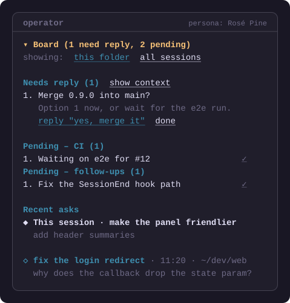 |
| **To-do**<br><br>A to-do list for the folder, shared by every session in it. Claude proposes items, you approve them.<br><br>Turn on **autopilot** and Claude starts the next item when it finishes one. It stops at a cap, on a question, or when usage reaches your warn line. | 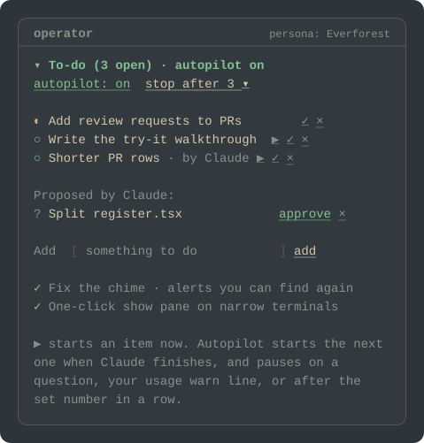 |
| **Usage**<br><br>Context used, 5-hour and weekly limits with when they reset, and session cost.<br><br>**Advisor** counts Claude's advisor calls this session; **/advisor** picks its model or turns it off.<br><br>**Model** shows the model Claude is answering with and its tokens this session (in, out, % cached), with any other model it used below; **/model** switches.<br><br>Meters turn amber at your warn line and red at your stop line. **Log** saves a labelled reading. | 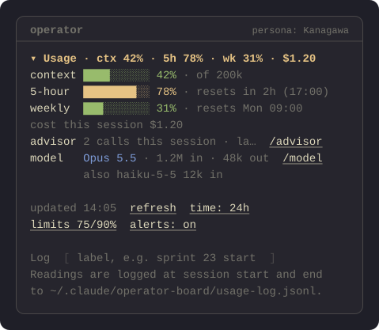 |
| **Git**<br><br>Branch, changed files, ahead and behind, with **review** (`/code-review`) and **commit**.<br><br>**Claude changed N files +a −b**: the files Claude edited this session, until they're committed.<br><br>The header offers the branch's next step: **push**, or **open PR**.<br><br>**CI on a pushed branch** shows before there's a PR (`CI red: lint`), and **run** buttons (**test**, **lint**, **typecheck**, **build**) come from your `package.json` scripts or Makefile. | 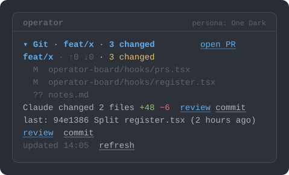 |
| **Sessions**<br><br>Earlier sessions with **resume**, **continue** (from its checkpoint) and **copy cmd** (works from any folder).<br><br>**checkpoint** and `/savepoint` save where this session stands. | 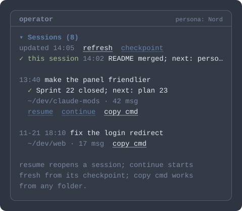 |
| **Quick prompts**<br><br>Prompts you pin with `/quick` or **Pin**; click one to put it in the prompt box.<br><br>**/btw** starts a side question that doesn't interrupt Claude.<br><br>*You often send* suggests prompts you repeat, with **+ pin**. | 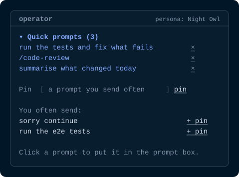 |
| **PRs**<br><br>Your open PRs, two lines each: the title, then what's wrong, CI and age. A PR that needs work gets **fix CI**, **address threads** or **address review**.<br><br>**Ready** PRs get **merge**. **To review** lists PRs that ask for your review, with **review**. Buttons fill the prompt; nothing is sent until you press Enter. | 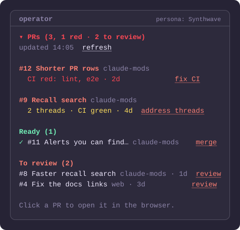 |
| **Recall**<br><br>Search earlier questions, by words or `"a phrase"`, and open one to see the answer it got. `/recall <words>` searches straight from the prompt. | 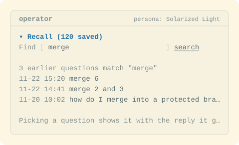 |

### Alerts

When a turn ends with a question for you, a PR's CI fails or passes, or usage crosses your limits, operator-board:

1. chimes and sends a system notification titled `Claude · <folder>`, so you know which session it came from;
2. adds the alert to the **● Alerts** strip at the top of the pane, where it stays until you tick it ✓ or **dismiss all**;
3. removes reply alerts by itself once you answer or mark the item done.

Whether a banner appears depends on your Claude Code notification setting (`preferredNotifChannel`) and your terminal's notification settings. `/alerts off` turns alerts off and `/alerts on` turns them back on.

### The band

A row above the prompt with shortcuts into the pane: the board (with how many need a reply), recall, PRs (with a red dot when CI fails) and the alert count. While the pane waits hidden on a narrow terminal, it starts with **▸ show operator pane**.

While subagents run, the **crew** shows under it: one row per agent with what it's on now, its type, model, time and tokens. **view** opens the agent's transcript, **msg** opens a box to send it a message, and **stop** stops it. Finished agents stay a minute, then drop off. Click **crew** to fold it to one line.


### Commands

| Command | What it does |
|---|---|
| `/operator` | Open or close the pane |
| `/board` · `/prs` · `/sessions` | Open or fold that section (`/prs` also refreshes) |
| `/recall [words]` | Open Recall, searching for the words if given |
| `/savepoint` | Save a checkpoint of this session, which Sessions can continue from |
| `/quick` | Pin a quick prompt |
| `/alerts [on\|off]` | Turn alerts on or off |
| `1`–`8` | With the pane focused (click it, or ctrl+x tab): open or fold Board, To-do, Usage, Git, Sessions, Quick prompts, PRs, Recall |

Claude also gets three tools, `board_update`, `todo_update` and `checkpoint_save`. Claude uses them to post questions and pending work to the board, keep the to-do list and save checkpoints. You don't call these yourself.

## persona

Type `/persona` and use ↑/↓ to preview, Enter to pick. Your choice is remembered across sessions.


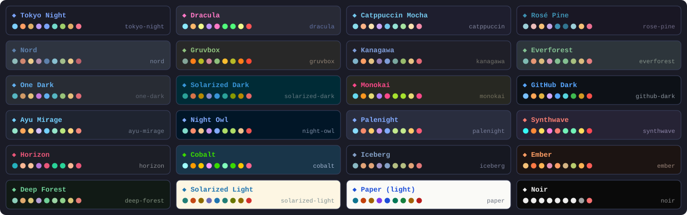

A persona changes Claude's replies, the tool-row icons, the spinner and footer words, the band, and the terminal's own 16 colours plus background, text and cursor. While Claude works, the band shows an animated scene such as rain, snow or stars. Make your own with `/persona new <name> <bg> [fg] [accent …]`, or ask Claude: "make me a persona that feels like a sunset."

Code blocks in Claude's replies have a **copy** button, and no side border, so selecting the lines copies just the code. `/persona replies off` hands replies back to Claude Code's own drawing.

Every command and setting is in [persona/README.md](persona/README.md).

## guard

Before Claude runs a shell command, guard reads it and stops the common slips: a push or force-push onto `main`, deleting a protected branch, or `rm -rf` on `/`, `~`, a `$VARIABLE` or anything outside the project. Claude gets a reason it can act on ("push a branch of your own and open a PR"), and you get a toast. It also takes `Co-Authored-By: Claude` and "Generated with Claude Code" lines out of commits and PR bodies.


`/guard` shows what it stopped, and `/guard off` turns it off. It's a seatbelt, not a sandbox. Every rule and setting is in [guard/README.md](guard/README.md).

## diff-cards

Each edit's diff folds to one line, `+12 −18 · 2 hunks`, so a long session doesn't turn into a wall of red and green. **show diff** unfolds Claude Code's own diff in place. Small diffs, and everything in the ctrl+o transcript, are left as they are. See [diff-cards/README.md](diff-cards/README.md).

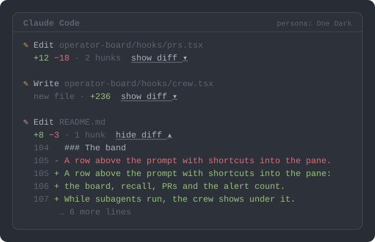

## turn-meter

Each turn's closing line gets its tokens and cost: `Baked for 42s · 180k in · 3.1k out · $0.41`. A turn of $0.50 or more is drawn in amber, so the expensive ones stand out when you scroll back. The cost is how much the session's total rose during the turn, so subagents and advisor calls in it count. See [turn-meter/README.md](turn-meter/README.md).

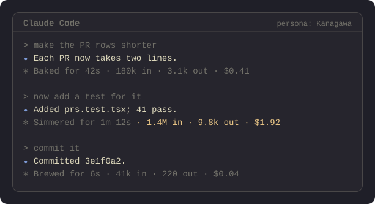

## chimes

Soft sounds, so you can look away while Claude works: **finished** after a turn of 20 seconds or more, **needs you** for a permission prompt, and **passed** or **failed** when a mod's notification says so (operator-board's CI alerts). Sounds that land together play once, the most urgent, and nothing plays while you're typing. `/chimes test` plays all four. With operator-board, turn off its **Alert sound** setting so you hear only chimes. See [chimes/README.md](chimes/README.md).


## focus

`/focus-timer 25` puts `◉ focus · 18m left` in the status line. Until the break, other mods' desktop notifications (operator-board's alerts) and sounds (chimes) wait. Then one notification tells you what you missed. Claude Code's own permission prompts are never held. `/focus-timer stop` ends it early. See [focus/README.md](focus/README.md).


## Try it

A walkthrough in your own repo. It makes a throwaway branch and PR, which you delete at the end.

1. **What Claude changed.** Ask Claude: *"create a branch try-panel and add a line to notes.md"*. Open **Git**, and you'll see `Claude changed 1 file +1 −0` with **review** and **commit**. Press **commit**, then Enter. The line goes once the change is committed.
2. **push, then open PR.** The Git header shows **push**. Press it, then Enter. Once the branch is pushed it shows **open PR**: press it, then Enter. `/prs` refreshes the PRs section straight away.
3. **CI passed, then merge.** When the PR's checks go green, you get the **CI passed** alert, and the PR moves under **Ready** with a **merge** button. Close the PR on GitHub instead, and delete the branch.
4. **To review** shows up when someone else asks you to review a PR. GitHub doesn't let you request your own review.
5. **Run buttons and hotkeys.** In a project with a `package.json` (scripts like `test` or `lint`) or a Makefile, open **Git** and press **test**: the prompt fills with the right command. Click the pane and press `4` to fold Git again.

## Update and uninstall

```sh
claude plugin marketplace update claude-mods
claude plugin update operator-board@claude-mods
claude plugin update persona@claude-mods
claude plugin update guard@claude-mods
claude plugin update diff-cards@claude-mods
claude plugin update turn-meter@claude-mods
claude plugin update chimes@claude-mods
claude plugin update focus@claude-mods          # then restart Claude Code
```

```sh
claude plugin uninstall operator-board@claude-mods
claude plugin uninstall persona@claude-mods
claude plugin uninstall guard@claude-mods
claude plugin uninstall diff-cards@claude-mods
claude plugin uninstall turn-meter@claude-mods
claude plugin uninstall chimes@claude-mods
claude plugin uninstall focus@claude-mods
claude plugin marketplace remove claude-mods
```

## Develop

Clone the repo and add it as a local marketplace instead of the GitHub one:

```sh
git clone https://github.com/kg-ng/claude-mods.git
claude plugin marketplace add ./claude-mods
claude plugin install operator-board@claude-mods
claude plugin install persona@claude-mods
claude plugin install guard@claude-mods
```

Test and validate before you open a PR:

```sh
cd operator-board && claude plugin test . && claude plugin validate .
cd ../persona && claude plugin test . && claude plugin validate .
```

Bump the mod's `version` in its `.claude-plugin/plugin.json` with every change, or `claude plugin update` won't pick the change up, and add an entry for it to [CHANGELOG.md](CHANGELOG.md). The GitHub check fails a PR that changes a mod without doing both (changes to tests and READMEs need neither). Then run the update commands above.

Once a version is merged, tag it and publish its release, with the notes from its CHANGELOG entry:

```sh
git tag -a operator-board-v0.15.0 <commit> -m "operator-board 0.15.0"
git push origin operator-board-v0.15.0
gh release create operator-board-v0.15.0 --verify-tag --title "operator-board 0.15.0" --notes "…"
```

The README pictures are SVGs in `docs/images/`, drawn by two scripts. If you change what the pane draws, change the scripts to match and run them again:

```sh
python3 docs/tools/draw_pictures.py docs/images persona/hooks/themes.ts
python3 docs/tools/draw_animations.py docs/images persona/hooks/themes.ts
```

## Contributing

Pull requests are welcome. `main` is protected: every change needs a pull request approved by the code owner, [@kg-ng](https://github.com/kg-ng) (see [CODEOWNERS](.github/CODEOWNERS)), and the **check** workflow must pass. That workflow validates the marketplace and every mod, with no warnings allowed, and runs their tests. Force-pushes and deleting `main` are blocked.

## License

[MIT](LICENSE)
