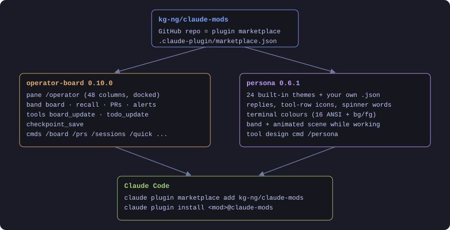
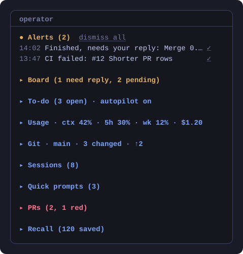
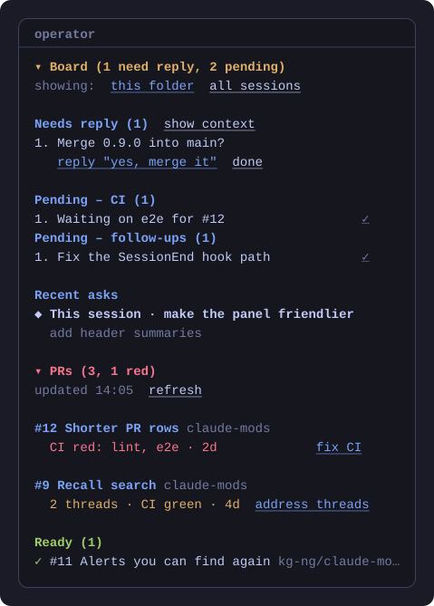
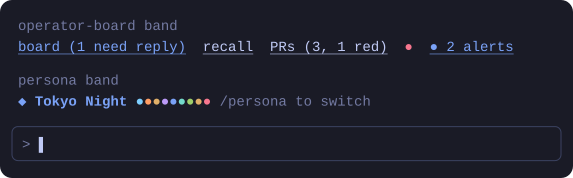

# claude-mods

Two mods for [Claude Code](https://claude.com/claude-code), published as a plugin marketplace:

| Mod | Version | What it does |
|---|---|---|
| [`operator-board`](operator-board) | 0.14.0 | One side pane for running a session: a board of what's waiting on you, a to-do list with autopilot, usage, git, earlier sessions, quick prompts, your PRs and recall. Alerts you can find again. |
| [`persona`](persona) | 0.7.1 | Themes for the terminal, Claude's replies and the panels: colours, tool icons, spinner words and an animated scene while Claude works. 24 built-ins, or make your own. |



> The pictures and animations in this README are drawn from the mods' render code with sample data. They are illustrations, not screenshots.

## Requirements

- Claude Code with plugin hooks modules (built on 2.1.323; the GitHub check runs 2.1.330).
- `git` for the Git section, and the [GitHub CLI](https://cli.github.com) (`gh auth login`) for the PRs section. Everything else works without them.
- The operator pane docks on the right in Claude Code's fullscreen layout from 110 columns. Below that it sits above the prompt instead.

## Install

```sh
claude plugin marketplace add kg-ng/claude-mods
claude plugin install operator-board@claude-mods
claude plugin install persona@claude-mods
```

You can install either mod on its own. **Restart Claude Code** afterwards to load them.

To check they loaded, type `/operator` (the pane opens) and `/persona` (the picker opens).

## operator-board

### See it in action

**How an alert works:** Claude finishes with a question, you hear a chime and get a notification named after the folder, the alert waits in the pane, and it clears itself once you answer.



**From an edit to a merge:** Git shows what Claude changed, the header offers **push** and then **open PR**, and when CI goes green you get an alert and a **merge** button.



### The pane

- **Open or close it** with `/operator`. It also opens by itself when a session starts.
- **Width:** it follows your terminal. Claude Code gives it a share of the window (at most 45%) and resizes it with the window. Drag its edge to pick your own width, and Claude Code keeps it.
- **Narrow terminals:** Claude Code only shows a pane that opened by itself on a terminal at least 144 columns wide, or 110 once you've opened it yourself and left it open. On a narrower terminal, click **▸ show operator pane** above the prompt, or type `/operator`. In Apple Terminal, a smaller font (Cmd and −) gives you more columns.
- **Folded headers:** every section starts folded, and its header carries a one-line summary, so you can see what needs you without opening anything. Click a header to open it.



Header colours: **amber** when something waits on you (a reply, a usage warning) and **red** when something is broken (failing CI, usage past your stop line). Sections that need you move to the top of the pane, and go back to their place once they're handled.

When the pane is taller than its window, a scrollbar on the right shows where you are. Scroll with the mouse wheel, or click the pane and use the arrow and page keys.

| Section | What it shows |
|---|---|
| **Board** | *Needs reply*: questions Claude asked you, each with a button that fills your answer into the prompt. *Pending*: open work grouped by section (CI, follow-ups, your action). *Recent asks* from this and other sessions. Switch between "this folder" and "all sessions". |
| **To-do** | A to-do list for the folder, shared by every session in it. Claude proposes items, you approve them. Turn on **autopilot** and Claude starts the next item when it finishes one. It stops at a cap, or when usage reaches your warn line. |
| **Usage** | Context used, 5-hour and weekly limits, and session cost. |
| **Git** | Branch, changed files, ahead and behind, and buttons that fill in `/code-review` or a commit request. When Claude has edited files this session, one line shows them, `Claude changed 4 files +120 −30`, with **review** and **commit**, until they're committed. The header offers the branch's next step: **push** (not pushed, or new commits) or **open PR** (pushed, no PR yet). |
| **Sessions** | Earlier sessions with **resume**, **continue** and **copy cmd**, plus checkpoints saved with `/savepoint`. |
| **Quick prompts** | Prompts you pin with `/quick` and send with one click. |
| **PRs** | Your open PRs, two lines each: the title, then what's wrong, CI and age (`CI red: lint, e2e · 2d`). A PR that needs work gets a button on that line that fills the prompt: **fix CI**, **address threads** or **address review**. Nothing is sent until you press Enter. PRs that are ready collapse to one line each, with a **merge** button. **To review** lists PRs where someone asked for your review, each with a **review** button (`/code-review <number>` for this repo), and the folded header counts them: `PRs (2, 1 red · 3 to review)`. |
| **Recall** | Search earlier questions and answers. |



### Alerts

When a turn ends with a question for you, a PR's CI fails or passes, or usage crosses your limits, operator-board:

1. chimes and sends a system notification titled `Claude · <folder>`, so you know which session it came from;
2. adds the alert to the **● Alerts** strip at the top of the pane, where it stays until you tick it ✓ or **dismiss all**;
3. removes reply alerts by itself once you answer or mark the item done.

Whether a banner appears depends on your Claude Code notification setting (`preferredNotifChannel`) and your terminal's notification settings. `/alerts off` turns alerts off and `/alerts on` turns them back on.

### The band

A row above the prompt with shortcuts into the pane: the board (with how many need a reply), recall, PRs (with a red dot when CI fails) and the alert count. While the pane waits hidden on a narrow terminal, it starts with **▸ show operator pane**.



### Commands

| Command | What it does |
|---|---|
| `/operator` | Open or close the pane |
| `/board` · `/prs` · `/sessions` | Open or fold that section (`/prs` also refreshes) |
| `/recall [words]` | Open Recall, searching for the words if given |
| `/savepoint` | Save a checkpoint of this session, which Sessions can continue from |
| `/quick` | Pin a quick prompt |
| `/alerts [on\|off]` | Turn alerts on or off |

Claude also gets three tools, `board_update`, `todo_update` and `checkpoint_save`. Claude uses them to post questions and pending work to the board, keep the to-do list and save checkpoints. You don't call these yourself.

## persona

Type `/persona` and use ↑/↓ to preview, Enter to pick. Your choice is remembered across sessions.


A persona changes Claude's replies, the tool-row icons, the spinner and footer words, the band, and the terminal's own 16 colours plus background, text and cursor. While Claude works, the band shows an animated scene such as rain, snow or stars. Make your own with `/persona new <name> <bg> [fg] [accent …]`, or ask Claude: "make me a persona that feels like a sunset."

Code blocks in Claude's replies have a **copy** button, and no side border, so selecting the lines copies just the code. `/persona replies off` hands replies back to Claude Code's own drawing.

Every command and setting is in [persona/README.md](persona/README.md).

## Try it

A walkthrough in your own repo. It makes a throwaway branch and PR, which you delete at the end.

1. **What Claude changed.** Ask Claude: *"create a branch try-panel and add a line to notes.md"*. Open **Git**, and you'll see `Claude changed 1 file +1 −0` with **review** and **commit**. Press **commit**, then Enter. The line goes once the change is committed.
2. **push, then open PR.** The Git header shows **push**. Press it, then Enter. Once the branch is pushed it shows **open PR**: press it, then Enter. `/prs` refreshes the PRs section straight away.
3. **CI passed, then merge.** When the PR's checks go green, you get the **CI passed** alert, and the PR moves under **Ready** with a **merge** button. Close the PR on GitHub instead, and delete the branch.
4. **To review** shows up when someone else asks you to review a PR. GitHub doesn't let you request your own review.

## Update and uninstall

```sh
claude plugin marketplace update claude-mods
claude plugin update operator-board@claude-mods
claude plugin update persona@claude-mods        # then restart Claude Code
```

```sh
claude plugin uninstall operator-board@claude-mods
claude plugin uninstall persona@claude-mods
claude plugin marketplace remove claude-mods
```

## Develop

Clone the repo and add it as a local marketplace instead of the GitHub one:

```sh
git clone https://github.com/kg-ng/claude-mods.git
claude plugin marketplace add ./claude-mods
claude plugin install operator-board@claude-mods
claude plugin install persona@claude-mods
```

Test and validate before you open a PR:

```sh
cd operator-board && claude plugin test . && claude plugin validate .
cd ../persona && claude plugin test . && claude plugin validate .
```

Bump the mod's `version` in its `.claude-plugin/plugin.json` with every change, or `claude plugin update` won't pick the change up. Then run the update commands above.

The README pictures are SVGs in `docs/images/`, drawn by two scripts. If you change what the pane draws, change the scripts to match and run them again:

```sh
python3 docs/tools/draw_pictures.py docs/images persona/hooks/themes.ts
python3 docs/tools/draw_animations.py docs/images
```

## Contributing

Pull requests are welcome. `main` is protected: every change needs a pull request approved by the code owner, [@kg-ng](https://github.com/kg-ng) (see [CODEOWNERS](.github/CODEOWNERS)), and the **check** workflow must pass. That workflow validates the marketplace and both mods and runs their tests. Force-pushes and deleting `main` are blocked.

## License

[MIT](LICENSE)
