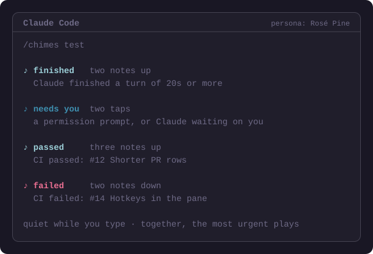

# chimes

Soft sounds, so you can look away while Claude works and still know when to come back.

| Sound | When |
|---|---|
| **finished** (two notes up) | Claude finished a turn that took 20 seconds or more |
| **needs you** (two taps) | A permission prompt, or Claude waiting for your input |
| **passed** (three notes up) | A mod's notification says CI passed, or a PR is ready or merged |
| **failed** (two notes down) | A mod's notification says CI failed, or usage passed your stop line |

Sounds that land together play once, the most urgent. Nothing plays within 5 seconds of a keystroke in the prompt, since you're already there. `/chimes test` plays all four.

Sounds play on macOS (`afplay`). Linux and Windows terminals have no player, so chimes stays silent there.

## Install

```sh
claude plugin marketplace add kg-ng/claude-mods
claude plugin install chimes@claude-mods
```

Restart Claude Code.



## With operator-board

chimes hears every desktop notification a mod sends, so operator-board's alerts (CI failed or passed, needs your reply, usage) each get their own sound. operator-board plays its own alert sound too: turn off its **Alert sound** setting in `/plugin` so you hear only chimes.

## Commands

| Command | What it does |
|---|---|
| `/chimes` | Whether they're on |
| `/chimes test` | Plays finished, passed, needs you, failed |
| `/chimes off`, `/chimes on` | Remembered across sessions |

## Settings

In `/plugin`, under chimes:

| Setting | Default | What it does |
|---|---|---|
| Chime when Claude finishes | on | |
| Only for turns this long (seconds) | `20` | Quick turns finish while you're watching |
| Chime when Claude needs you | on | Permission prompts and waiting for input |
| Chime for other mods' notifications | on | |
| Quiet while you type | on | No chime within 5 seconds of a keystroke |
| Volume | `0.7` | 0 to 1 |

The sounds are made by `tools/make_sounds.py` (plain sine tones), so you can change them and run it again.
