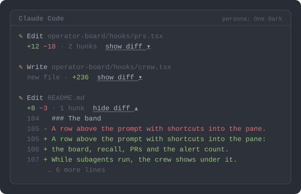

# diff-cards

Each edit Claude makes shows its whole diff in the transcript, and a long session turns into a wall of red and green. diff-cards folds each diff to one line, so you can see what changed at a glance and open only the diffs you want to read.

```
✎ Edit operator-board/hooks/prs.tsx
  +12 −18 · 2 hunks  show diff ▾
```

**show diff** unfolds Claude Code's own diff in place, and **hide diff** folds it again. Small diffs (6 changed lines or fewer) are drawn as they are, and so is every diff in the ctrl+o transcript. Failed edits and edits held for review keep Claude Code's own drawing too.

## Install

```sh
claude plugin marketplace add kg-ng/claude-mods
claude plugin install diff-cards@claude-mods
```

Restart Claude Code.



## Settings

In `/plugin`, under diff-cards:

| Setting | Default | What it does |
|---|---|---|
| Leave small diffs unfolded | `6` | A diff with this many changed lines or fewer is drawn in full; `0` folds every diff |
