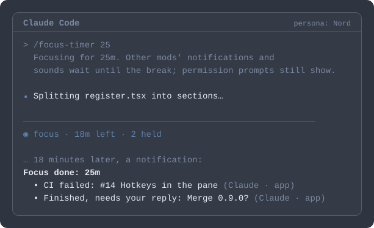

# focus

A focus timer in the status line. While it runs, other mods' notifications and sounds wait. At the break you get one notification with what you missed.

```
◉ focus · 18m left · 2 held
```

- `/focus-timer` starts 25 minutes (a setting); `/focus-timer 50`, `/focus-timer 90m` or `/focus-timer 1h` for another length.
- `/focus-timer stop` ends it early, and still gives you what was held.
- **Held:** every mod's desktop notification (operator-board's CI, needs-reply and usage alerts) and, with **Hold sounds too** on, their sounds (chimes). They don't need to know about focus: it holds them on the way out.
- **Not held:** Claude Code's own permission prompts and questions. They show in the terminal as always, so Claude never waits on you without you seeing it.

(Claude Code has its own `/focus` command, so this one is `/focus-timer`.)

## Install

```sh
claude plugin marketplace add kg-ng/claude-mods
claude plugin install focus@claude-mods
```

Restart Claude Code.



## Settings

In `/plugin`, under focus:

| Setting | Default | What it does |
|---|---|---|
| Default length (minutes) | `25` | How long `/focus-timer` runs when you don't say |
| Hold sounds too | on | Mute other mods' sounds while focusing |
