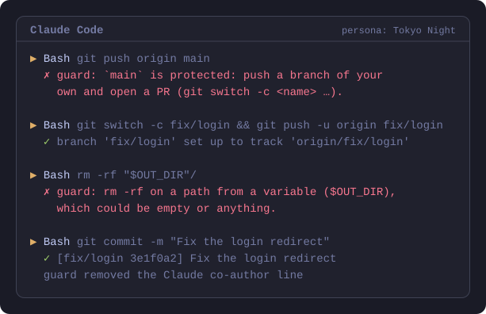

# guard

A seatbelt for Claude's shell commands. Before Claude runs a command, guard reads it and stops the common slips, with a reason Claude can act on. It also takes Claude's co-author lines out of your commits and PR bodies.

It's a seatbelt, not a sandbox: it reads the command as written, so a determined script can get around it. Your own `!` commands never go through it.

## Install

```sh
claude plugin marketplace add kg-ng/claude-mods
claude plugin install guard@claude-mods
```

Restart Claude Code.



## What it stops

| Rule | Stops | Passes |
|---|---|---|
| `push-protected` | `git push origin main`, `git push` while on `main` | `git push -u origin feat/x` |
| `force-protected` | `git push -f origin main`, `--force-with-lease`, `+main` | `git push --force-with-lease origin feat/x` |
| `delete-protected` | `git push origin --delete main`, `git push origin :main` | deleting your own branches |
| `push-all` | `git push --mirror`, `--all` | |
| `rm-outside` | `rm -rf` on `/`, `~`, a `$VARIABLE`, `..`, a path outside the project, or the whole project (`.`) | `rm -rf dist node_modules` |

Each part of a command is checked: `cd x && git push -f origin main` is stopped. Quoted text and heredoc bodies are not commands, so `echo "git push -f origin main"` runs.

When guard stops a command, Claude gets the reason ("`main` is protected: push a branch of your own and open a PR") and you get a toast.

## Co-author lines

With **Strip Claude co-author lines** on (the default), guard removes `Co-Authored-By: Claude …` and `🤖 Generated with [Claude Code]…` lines from `git commit` messages and `gh pr create`, `edit` and `merge` bodies before they run. Co-authors who aren't Claude stay.

## Commands

| Command | What it does |
|---|---|
| `/guard` | Whether it's on, and what it stopped this session |
| `/guard off` | Lets Claude's commands run unchecked, remembered across sessions |
| `/guard on` | Turns it back on |

## Settings

In `/plugin`, under guard:

| Setting | Default | What it does |
|---|---|---|
| Protected branches | `main,master` | Branches Claude may not push to directly, comma-separated |
| Strip Claude co-author lines | on | See above |
