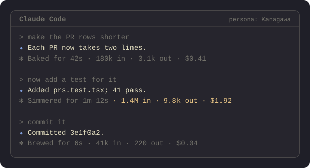

# turn-meter

Shows what each turn cost, right where the turn ends:

```
Baked for 42s · 180k in · 3.1k out · $0.41
```

- **in** is every input token the turn sent, the prompt cache's included. A long session's context goes out with every request, so this number grows as the session does.
- **out** is what Claude wrote.
- **$** is how much the session's cost (as `/cost` totals it) rose during the turn, so it includes any subagents and advisor calls made in that turn.

A turn that cost $0.50 or more is drawn in amber, so the expensive ones stand out when you scroll back. The ctrl+o transcript keeps Claude Code's own line.

## Install

```sh
claude plugin marketplace add kg-ng/claude-mods
claude plugin install turn-meter@claude-mods
```

Restart Claude Code.



## Settings

In `/plugin`, under turn-meter:

| Setting | Default | What it does |
|---|---|---|
| Expensive turn (USD) | `0.5` | A turn that cost this much or more is drawn in amber; `0` turns it off |

## How it lines up

The closing line doesn't say which turn it closes, so turn-meter matches it to the turn that just ended by its length (to within 2 seconds). Turns from before the mod loaded, or from a resumed session, keep their plain line.
